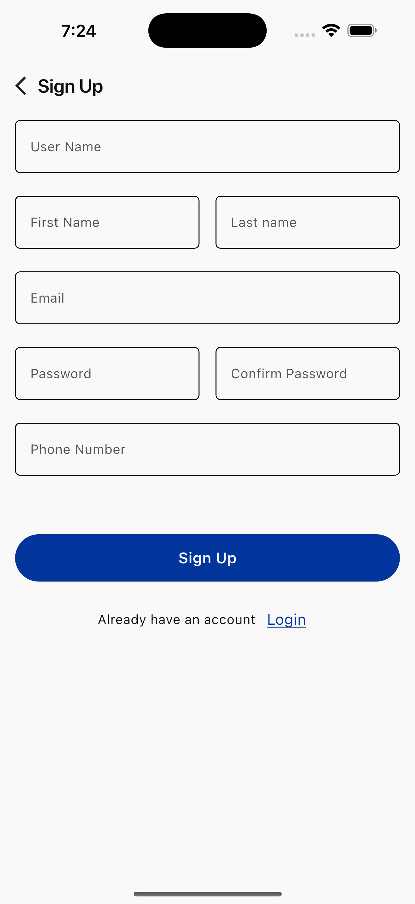
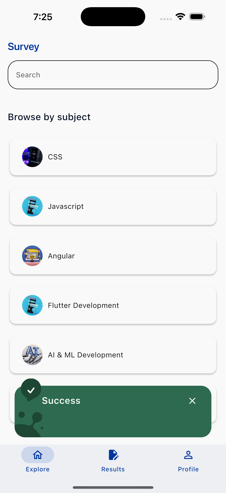
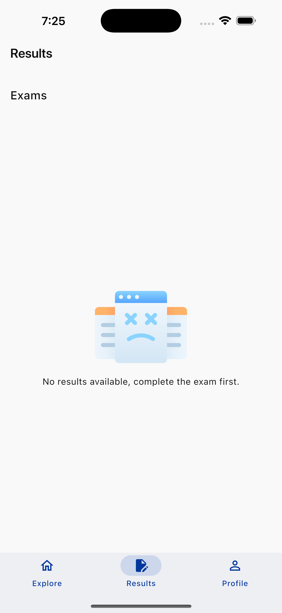
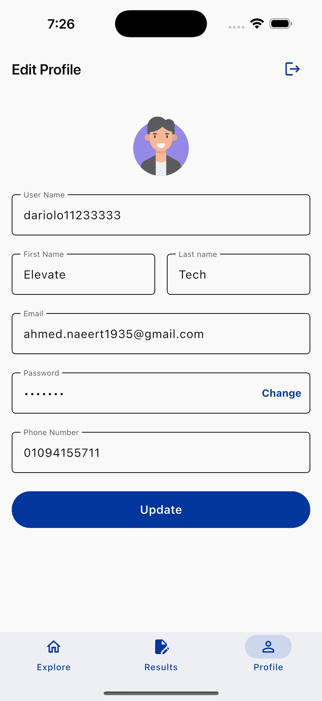
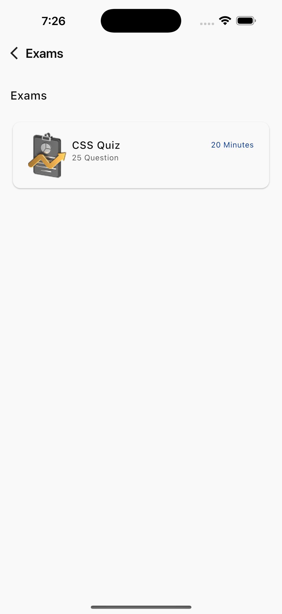
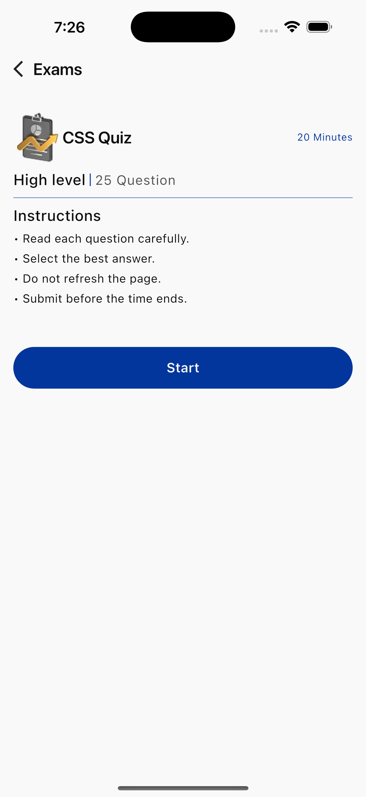
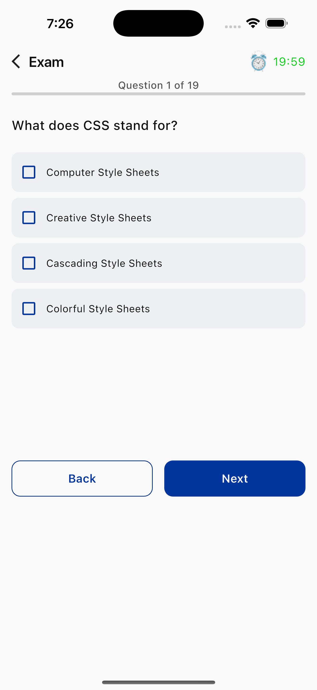
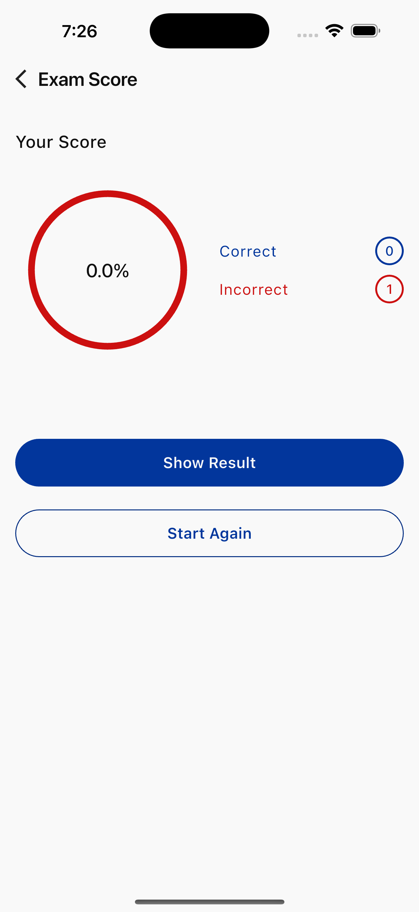
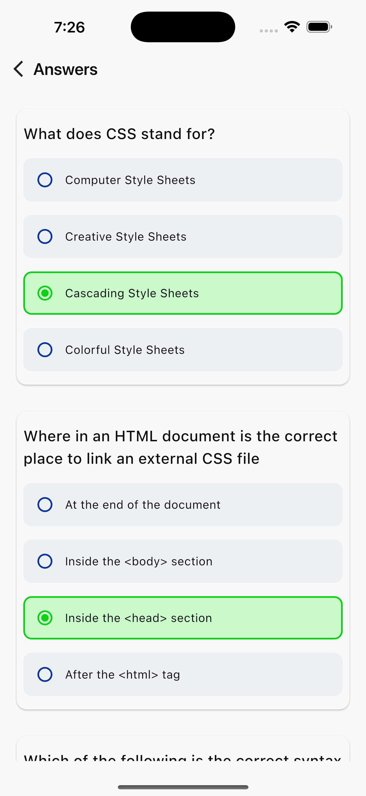

# 📘 Elevate Online Exams – Flutter Application

A modern and user-friendly Flutter application designed to streamline online examinations for students, teachers, and educational institutions.  
The app provides secure authentication, timed exams, detailed results, and a smooth experience powered by a clean architecture and scalable codebase.

---

## 🚀 Features Overview

### 🔐 Authentication
- Login & Register  
- Forget Password  
- Edit Profile  
- Change Password  
- Full form validation & error handling  

### 🏠 Home
- Explore available surveys/exams  
- View previous exam results  
- Manage personal profile  

### 🔎 Search
- Search subjects by keyword  

### 📝 Exams
- View exam instructions before starting  
- Timed exams with auto-submit  
- Multiple question types  
- Confirm dialog before submitting  
- Track remaining time  

### 📊 Results
- Detailed result breakdown  
- Grades, duration, and exam status  
- Correct vs wrong answers  

### 👤 Profile
- Update name, email, and personal info  
- Change password  

---

## 🛠️ Tech Stack & Tools

### ⚙️ Technical Overview
- **Framework:** Flutter  
- **Architecture:** Clean Architecture (Data – Domain – Presentation – API)  
- **Pattern:** MVVM  
- **State Management:** Cubit  
- **Database:** Hive + Shared Preferences  
- **Networking:** REST API (Dio Module)  
- **Local Storage:** Hive, Secure Storage  

### 📐 Tools & Technologies
- Version Control: Git & GitHub  
- UI/UX Design: Figma  
- API Testing: Postman  
- IDE: Android Studio / VS Code  

---

## 🖼️ Screenshots

| Screenshot | Screenshot | Screenshot | Screenshot |
|---|---|---|---|
|  |  |  |  |
|  |  |  |  |
|  |  |  |  |

---

## 🏗️ Project Structure

lib/
├── core/
│ ├── base_state/
│ ├── config/
│ ├── constant/
│ ├── custom_widgets_model/
│ ├── error/
│ ├── helper_function/
│ ├── local_data/
│ ├── module/
│ ├── route/
│ ├── theme/
│ ├── use_case/
│ └── widgets/
├── features/
│ ├── auth/
│ │ ├── forget_password/
│ │ ├── signin/
│ │ └── signUp/
│ ├── home/
│ │ ├── presentation/
│ │ └── sections/
│ └── splash/
│ ├── data/
│ ├── domain/
│ ├── external/
│ └── presentation/
└── main.dart

## 🧩 Core Module (`lib/core`)

This module contains foundational components and utilities used across the application:

- `base_state/`: Base classes for state management  
- `config/`: Dependency injection setup (`di.dart`)  
- `constant/`: App constants, API routes, assets  
- `custom_widgets_model/`: Data models for widgets  
- `error/`: Error & failure handling  
- `helper_function/`: Formatting, validation, utilities  
- `local_data/`: Hive & secure storage implementations  
- `module/`: Third-party modules (e.g. Dio)  
- `route/`: Routing and navigation logic  
- `theme/`: App themes and colors  
- `use_case/`: Abstract domain use cases  
- `widgets/`: Shared custom widgets  

---

## 🔗 Features Module (`lib/features`)

- `auth/`: Login, signUp, forget password flows  
- `home/`: Dashboard, surveys, results  
- `splash/`: App initialization layers (data, domain, presentation)  

---

## ▶️ Getting Started

```bash
flutter pub get
flutter run
